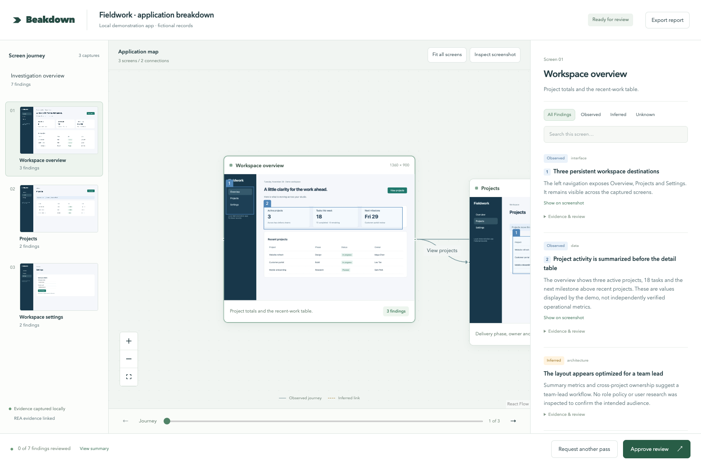
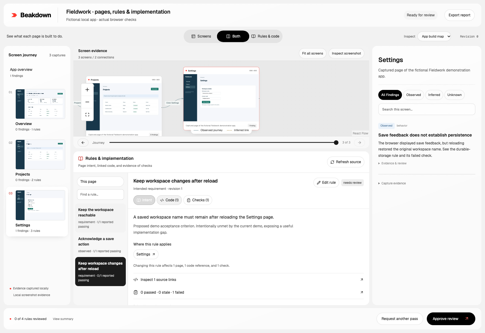

# Beakdown

Review your AI's work with screenshots and evidence you can check.

When an AI agent reviews your website or prepares changes to your data, you need a way to check its work. Beakdown gives you a browser workspace with screenshots, findings and results you can inspect. You can correct a finding, request a change, and send your feedback to the agent.



## What would I use it for?

| You want to... | Beakdown helps you... |
| --- | --- |
| Understand a website or app | Follow captured screens and see what the agent learned about each one. |
| Check whether a feature works as intended | Review the expected behavior, linked code and reported checks together. |
| Explain what needs changing | Add corrections and change requests beside the relevant finding or rule. |
| Review a data task before the agent continues | Inspect each step and sample results, adjust a query, and approve the reviewed plan. |

You can review screenshots and describe the behavior you want without reading code. Installation, source-code inspection and SQL editing need technical knowledge. Once the tools are configured, your agent prepares the review and gives you a link to open.

## How a review works

1. **Ask your agent to look at something.** For example: "Use Beakdown with REA to review this website. Capture the main screens and explain how someone moves through them."
2. **Open the review link.** The agent gathers the evidence and arranges it in Beakdown. REA is the separate tool that captures the app or website.
3. **Check the findings against the screenshots.** See what the agent observed, what it inferred, and what it still cannot answer.
4. **Leave your feedback.** Confirm a finding, dispute it, or write a correction. If the review includes app rules, you can edit the required behavior and request a change.
5. **Return to your agent.** Use the copied handoff prompt to have it retrieve your feedback. The agent handles any implementation and testing separately.

You can approve the report or request another pass. Approval records your assessment of that report. Known failures, disputed findings and your notes remain part of the result; approving does not deploy changes or establish that every conclusion is correct.

## Example: the app says it saved, but forgets your change

The included demo has a workspace-name setting. It shows save feedback, but the new name disappears when you reload the page.

The example script captures the demo and runs browser checks. It records three passes and the failed save-and-reload check, then prepares a review linking the page, expected behavior, source code and results. You can inspect what happened and request a change to the save behavior.



In an app review, select a page and follow **Intent → Code → Checks**:

- **Intent:** what the feature should do, with requirements kept separate from observations and inferred rules.
- **Code:** the files and source excerpts the agent linked to that behavior.
- **Checks:** what the agent reports passed, failed, could not be tested, or needs checking again.

When you change a rule, Beakdown marks earlier checks as out of date. It shows the linked pages, code and checks so the agent can see what needs another look. Source refresh rechecks the declared local files, and approval checks for source changes too.

The agent supplies these relationships and check results. Beakdown validates the links and manages the review; it does not discover every dependency, run your app's tests, or independently prove that an agent's reported pass is correct.

<details>
<summary>Run the demo locally</summary>

After installation, run:

```sh
uv run --with playwright python examples/build_map_demo.py --output /absolute/folder/outside-the-repo
uv run beakdown-review /absolute/folder/outside-the-repo/investigation.json
```

This requires Chrome. To use Playwright Chromium instead, install it and set `BEAKDOWN_BROWSER=chromium`. The demo is fictional; the screenshots and browser-check outcomes come from actual runs against it.

</details>

## Screenshots and data in the same review

A website review can show captured screens alongside a data view of its findings. Selecting a screen narrows the displayed sample; selecting a linked result row takes you back to its screenshot. Choose Screens, Data flow or Both depending on what you need to inspect.

The default analysis groups the report's findings by screen and shows which need human review. Technical users can edit the SQL to ask a different question. Confirming or disputing a finding updates the analysis, and approval waits for computation to finish.

For a separate data task, the agent can prepare a sequence of read-only SQL steps. You can inspect the tables, change a query and review the new results before approving. Queries run locally in DuckDB. Beakdown does not make production changes.

## Before you rely on a review

- **Capture coverage matters.** A review describes the screens and states the agent inspected. A screenshot alone cannot establish what happens in a backend, whether permissions work, or whether a saved value survives a reload.
- **Tables show samples.** Previews contain up to 50 rows. A row missing from the preview may still exist in the full result.
- **Save your report before leaving.** Sessions expire after one hour and end when the MCP process stops. Export downloads a ZIP containing the report and evidence. Reopening that ZIP in the canvas is not supported yet.
- **The timeline shows the current run.** It lets you inspect the ordered steps, but does not retain previous executions.

Exported investigations include reviewed findings, corrections and normalized screenshots. App reviews also include source excerpts and check references; data analysis adds queries, previews and Arrow files. Session credentials are excluded. Review exported material before sharing it, since screenshots and source excerpts can contain private information.

## Install and connect your agent

Setup requires Python 3.11+, uv, Node 20.19+ and pnpm 10. If you only need to review the results, someone who manages your agent setup can handle this part.

```sh
uv sync
pnpm install
pnpm build
uv run beakdown-mcp
```

MCP is the connection that lets your AI agent call Beakdown's tools. Add this server configuration to your agent, replacing the path with the location of your Beakdown checkout:

```json
{
  "mcpServers": {
    "beakdown": {
      "command": "uv",
      "args": [
        "--directory",
        "/absolute/path/to/beakdown",
        "run",
        "beakdown-mcp"
      ]
    }
  }
}
```

For website and app capture, configure REA as well. Install [the Beakdown skill](skills/beakdown/SKILL.md) in your agent's skill directory so it knows how to gather evidence and prepare the review. For Codex, copy `skills/beakdown` to `~/.agents/skills/beakdown`. Reconnect or restart your agent if needed. Installing the skill does not register either MCP server.

Once connected, ask:

> Use Beakdown with REA to review this website: https://your-site.example. Capture its main screens, explain the journey, and show me the findings with their evidence.

For an app you are building, ask:

> Use Beakdown with REA to show what this app's pages should do, where that behavior is implemented, and what the checks found. Highlight failures and anything that still needs checking.

## Technical reference

<details>
<summary>Prepare a screenshot investigation</summary>

After capturing evidence, the agent calls `create_investigation_session`. This example shows the input structure; replace the paths and findings with actual captured evidence:

```json
{
  "title": "Customer portal investigation",
  "target": "https://your-site.example",
  "summary": "What the agent learned, grounded in the captures.",
  "screens": [
    {
      "id": "home",
      "title": "Home screen",
      "description": "The starting point of the inspected journey.",
      "rea_evidence_path": "/absolute/path/to/rea-evidence.json",
      "rea_evidence_id": "ev_exact_id_from_rea",
      "capture_index": 0
    }
  ],
  "findings": [
    {
      "id": "navigation",
      "screen_id": "home",
      "title": "Persistent workspace navigation",
      "detail": "Replace this example with a conclusion supported by the actual capture.",
      "confidence": "observed",
      "category": "interface",
      "evidence_ids": ["ev_exact_id_from_rea"],
      "region": { "x": 0.01, "y": 0.1, "width": 0.15, "height": 0.3 }
    }
  ],
  "connections": [],
  "limitations": ["Only the captured routes and states were inspected."]
}
```

Each screen takes exactly one absolute `rea_evidence_path` or `screenshot_path`. Beakdown accepts REA web screenshots, browser/Electron scenarios and native UI scenarios, as raw records, MCP JSON envelopes or exported bundles. Use `rea_evidence_id` to select a bundle record. `capture_index` selects a captured screenshot and defaults to the last one.

Other capture tools can provide local PNG, JPEG or WebP screenshots. Beakdown displays imported evidence; it does not fetch the target or execute its HTML and scripts.

If the MCP tool is not loaded in your agent yet, save the input as a JSON manifest and run:

```sh
uv run beakdown-review /absolute/path/to/investigation.json
```

The command starts the local server, opens the canvas and stays alive until Ctrl+C. Add `--no-open` to print the URL without opening a browser. A saved input manifest can create another session, but does not preserve later review changes unless they are included in that input.

Screenshots are validated and converted to WebP. REA-provided image digests are checked, and provenance and capture limitations remain visible. Limits are 24 MB per complete evidence JSON file; 8 MB and 20 megapixels per input screenshot; 32 MB of normalized images, 50 screens and 300 findings per session.

For linked app rules, source snapshots and check freshness, see the [build-map input and lifecycle](docs/build-map-contract.md).

</details>

<details>
<summary>Prepare a data pipeline for review</summary>

Call `create_handoff_session` with the steps and their connections:

```json
{
  "title": "Inspect active customers",
  "nodes": [
    {
      "id": "customers",
      "title": "Sample customers",
      "operation_type": "load",
      "sql_or_expr": "SELECT * FROM (VALUES (1, 'ACTIVE', 700), (2, 'INACTIVE', 20)) t(id, status, spend)"
    },
    {
      "id": "buyers",
      "title": "Active top buyers",
      "operation_type": "filter",
      "sql_or_expr": "status = 'ACTIVE' AND spend > 500"
    }
  ],
  "edges": [{ "source": "customers", "target": "buyers" }]
}
```

Open the returned inspection URL. After the human reviews it, call `get_session_result` with the returned `session_id` and `token`. Only proceed if `approved` is true, using the returned pipeline. "Approve & Commit" records the approval decision; the agent executes any production changes separately.

Steps run in dependency order. SQL can refer to upstream tables by node ID; a filter takes one parent and a SQL predicate. Only a single DuckDB SELECT is accepted. Python expressions, exec, extensions, network access and production writes are not supported. Reading local data files requires their exact absolute paths in `allowed_paths` when creating the session; this explicitly grants read access.

Each step returns schema, full-table null counts, up to 50 sample rows and Arrow IPC. The combined preview JSON and Arrow must stay below 100,000 bytes. Large samples shrink; oversized schemas fail. DuckDB materializes intermediate tables with a 256 MB memory limit. The preview limit bounds browser transport, not total process memory. There is no query timeout or OS sandbox yet.

</details>

<details>
<summary>Customize investigation analysis</summary>

`create_investigation_session` accepts an optional `analysis_pipeline` (PipelineSpec), `analysis_links` (screen/node/finding associations), and `include_analysis` (true by default).

Queries can read `audit_findings`, `audit_screens`, `audit_connections` and upstream node IDs. Custom investigation pipelines cannot read external files. Set `include_analysis: false` for a review containing only screenshot evidence. Use `create_handoff_session` for standalone SQL transformations.

Selecting "All screens" broadens the displayed sample. Samples remain capped at 50 rows. Editing SQL recomputes the full pipeline; the timeline shows the current execution only.

</details>

<details>
<summary>Local server, sessions and approval</summary>

The local server binds to an OS-assigned port on the loopback interface. Credentials travel in the URL fragment and Authorization headers. The UI removes the fragment from the address bar after reading it. API responses are not cached; cross-origin requests and unexpected Host headers are rejected.

Sessions live in memory for one hour and end with the MCP process. Capacity is 32 sessions, with two background threads for work. Creation queues execution without waiting for previews; initial startup has no strict 50 ms guarantee.

Edits recompute the full pipeline. Revision checks prevent approval of an outdated revision. Historical execution snapshots are not persisted.

</details>

## Development

```sh
uv run pytest
pnpm build
pnpm dev
# In another terminal, after a production build (requires Chrome):
uv run --with playwright python tests/browser_smoke.py
uv run --with playwright python tests/build_map_browser.py
```

`pnpm dev` starts a separate UI development server on a dynamic port. For authenticated end-to-end sessions, use the built UI served by the local daemon.

The repository has three packages: `beakdown-core` for schemas, DuckDB, Arrow and FastAPI; `beakdown-ui` for the React Flow interface; and `beakdown-mcp` for MCP stdio and the review CLI. This release supports DuckDB SQL. Polars and persistent execution history are not implemented.

For a repeatable capture target, serve `examples/demo-site`. It is a fictional app built to test the review workflow. The documentation screenshots show actual browser captures of that demo.

## License

MIT.
